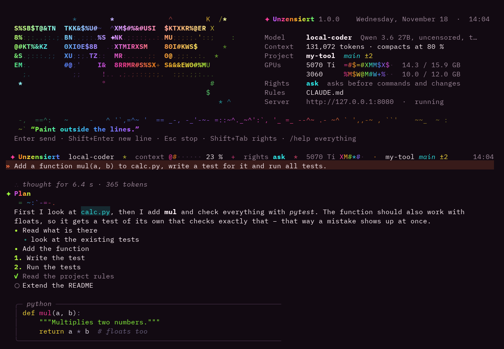
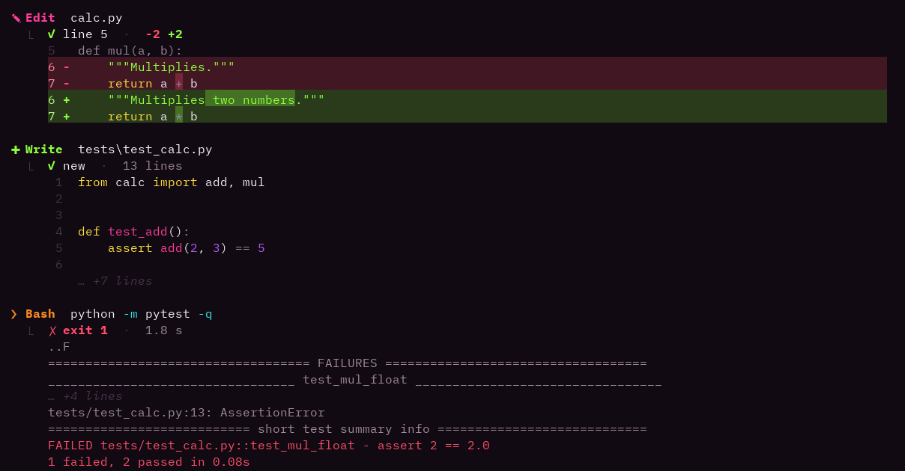
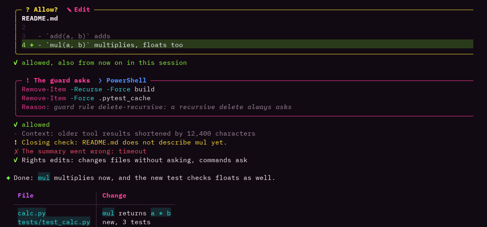
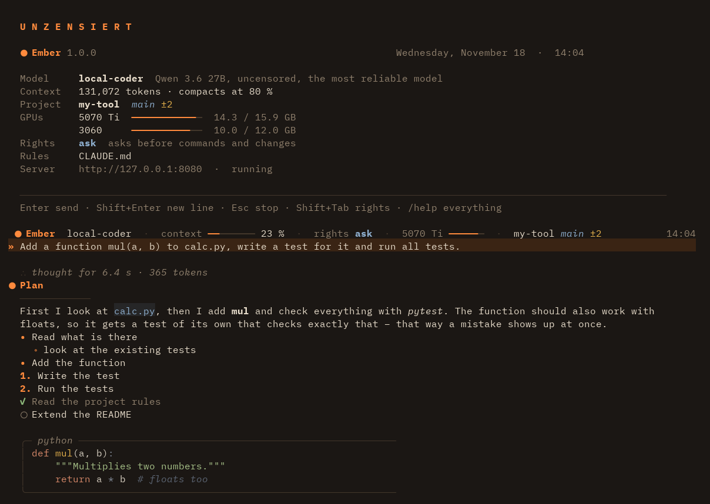

<div align="center">

# Unzensiert

**A coding agent that runs an uncensored model on your own graphics card.**<br>
No cloud · no token limit · your code never leaves your machine.

[](https://github.com/MD220411/Unzensiert/releases/latest)
[](LICENSE)


[](https://github.com/ggml-org/llama.cpp)


[Quick start](#quick-start) · [What it looks like](#what-it-looks-like) · [Compared with Claude Code](#compared-with-claude-code) · [Documentation](#documentation)

<sub>Free hobby project · for lawful use only · no warranty, use at your own risk · [Disclaimer](DISCLAIMER.md)</sub>

</div>



**Unzensiert** works in your project folder like a coding assistant from the cloud: it reads
and changes files, runs commands and tests, and checks its own work. The model runs locally
through [llama.cpp](https://github.com/ggml-org/llama.cpp), the agent is this project's own
program, written in the PowerShell every Windows already has. Nothing else needs to be
installed, and no account is needed.

## Highlights

- **Local and private.** Model, server and agent run on your computer. After the install
  everything works offline.
- **Uncensored models** (Qwen 3.6 27B and 35B-A3B, Qwen 3.8 27B, "Heretic" variants) with
  128k context and speculative decoding (MTP): 66–71 tokens/s on an RTX 5070 Ti + RTX 3060.
- **Faster than Claude Code with the same model:** in the benchmark Unzensiert finished all
  eleven tasks quicker, with a third fewer rounds ([details](#compared-with-claude-code)).
- **Fits your hardware.** The installer measures your graphics cards and computes how to
  spread the model over them and the main memory, instead of guessing
  ([planner](docs/planner.md)).
- **A guard instead of a censor.** The model refuses nothing; a guard protects your machine
  from destructive commands and asks before sensitive ones ([security](docs/security.md)).
- **Checks its own work.** Before it reports a task as done, a closing check runs the
  project's tests, reminds it of tests, README and settings, and after larger changes a
  second local model reviews the diff ([agent](docs/agent.md)).
- **A terminal that is fun to look at:** pictures made of characters, Markdown with tables,
  code in colour, diffs with marked characters, two styles ([look](docs/style.md)).
- **Updates itself** from the releases on GitHub, unless you switch that off.

## Quick start

**You need** 64-bit Windows 10 (1809) or 11, a graphics card with 12 GB or more (NVIDIA;
AMD and Intel are experimental), 32 GB of main memory, about 25 GB of free disk space and an
internet connection for the install.

**Install.** Open PowerShell (Start menu, type "PowerShell") and paste:

```powershell
irm https://raw.githubusercontent.com/MD220411/Unzensiert/main/install.ps1 | iex
```

Or download *Source code (zip)* of the [latest release](https://github.com/MD220411/Unzensiert/releases/latest),
unpack it and double-click **Install.cmd**. If Windows says "Windows protected your PC",
click "More info", then "Run anyway".

The installer looks at your machine and asks before it installs or downloads anything:

| Step | What happens |
|---|---|
| 1 | checks Windows, graphics cards and main memory |
| 2 | picks an install folder for llama.cpp, models and logs (the drive with the most free space) |
| 3 | installs Git for Windows if it is missing; Claude Code only if you want the comparison command (the question defaults to no) |
| 4 | installs llama.cpp in the build that fits your graphics card |
| 5 | downloads the model that fits your graphics memory (17 to 22 GB from Hugging Face, checked by SHA-256), then measures your cards, computes the layout and tests it (one to two minutes) |
| 6 | sets up the commands `unzensiert` and `claude-local` and asks whether new releases may install themselves |
| 7 | runs a short test |

**Use.** Open a new terminal window in your project folder and type:

```
unzensiert
```

Type what you want; Enter sends, Shift+Enter starts a new line, Esc stops the model. `/help`
lists the commands, `/model` switches between the models you have installed, Shift+Tab
switches how much the agent may do without asking (`ask`, `edits`, `all`).
`unzensiert -p "question"` answers once without a session.

**Updates.** `unzensiert` looks for a new release at most once a day and installs it (only
published releases, never work in progress). Switch it off with `unzensiert --updates off`,
look right now with `unzensiert --update`. **Update by hand:** run the install line again.
**Remove:** double-click **Uninstall.cmd**; it asks before deleting anything and leaves
Claude Code and Git in place.

## What it looks like

Every tool call shows its sign, a tick or cross and its duration; changes appear as a diff
with line numbers, and inside a changed line only the changed characters are marked.



Questions stand in a frame with the keys as badges; when the guard asks, the frame turns
pink. Answers are Markdown with aligned tables.



<details>
<summary>The calmer style "Night Shift"</summary>



</details>

Every element is described in [docs/style.md](docs/style.md#the-terminal-of-unzensiert).

## Compared with Claude Code

The same model (`local-coder`) and server, the same tools, rules and closing check, all eleven
benchmark tasks three times each with both agents (run `vergleich2`, 2026-11-18):

| | **Unzensiert** | Claude Code (`claude-local`) |
|---|---|---|
| Time, sum of the medians per task | **1,629 s** | 2,160 s |
| Rounds (requests to the model) | **268** | 418 |
| Tokens written by the model | **98,591** | 122,004 |
| First request of a task | **about 2,800 tokens** | about 26,000 tokens |
| Passed | 27 / 33 | 29 / 33 |
| Working rules followed | 88 / 96 | 86 / 96 |

Unzensiert was faster on every one of the eleven tasks. The difference in passing is within
chance (Fisher's exact test, p = 0.73); every failure with a wrong result is a mistake of the
model that also happened with Claude Code.

## Which model you get

The model depends on the graphics memory (all cards added up, `config\setups.json`). How it is
spread over your cards and main memory is not taken from a table: the installer measures how
fast each card and the main memory are, asks llama.cpp how much memory each layout needs, and
computes the fastest layout and the largest context that costs at most 15 % speed
([docs/planner.md](docs/planner.md)).

| Graphics memory | Model | Measured on | Layout by llama.cpp alone | Computed layout |
|---|---|---|---|---|
| 26 GB or more | `local-coder` (Qwen 3.6 27B) | RTX 5070 Ti + RTX 3060 | 44 tokens/s, 128k | **66–71 tokens/s**, 128k |
| 22 GB or more | `local-coder` | both cards limited to about 23 GB | 49 tokens/s, 64k | not measured |
| 15 GB or more | `local-coder`, partly in main memory | RTX 5070 Ti alone | 21 tokens/s, 64k | **22 tokens/s** at 64k; it picks 96k at 19 tokens/s |
| 11 GB or more | `local-fast` (Qwen 3.6 35B-A3B), experts partly in main memory | RTX 3060 alone | 62 tokens/s, 64k | **65 tokens/s** at 64k; it picks 128k at 58 tokens/s |
| 7 GB or more | `local-fast`, experts mostly in main memory | RTX 3060 with 4 GB kept free | 57 tokens/s, 64k | 54 tokens/s at 128k |
| no usable card | `local-fast` on the processor | Core i9-14900K | 26 tokens/s, 32k | |

Speeds are generation speeds with the model drafting ahead (MTP); they vary by a few percent
from run to run. `local-fast` answers faster but solves hard tasks less reliably
(`-Model local-fast` when installing). The single cards were measured by hiding the others
from llama.cpp; a real card of that size can be faster or slower. More models:
`scripts\Get-Model.ps1 -List`.

## Using it

In a terminal (also the one in VS Code) in your project folder. All details:
[docs/unzensiert.md](docs/unzensiert.md).

| Command | Effect |
|---|---|
| `unzensiert` | session with the default model of this computer (chosen by the installer) |
| `unzensiert "task"` | a session that starts right away with this task |
| `unzensiert -Model fast` | `local-fast` (Qwen 3.6 35B-A3B): about twice the tokens per second, less reliable on harder tasks |
| `unzensiert -Model qwen38` | `local-qwen38` (Qwen 3.8 27B): the earlier default model, for comparison |
| `unzensiert -p "question"` | a single answer without a session (`--output-format json` for scripts) |
| `unzensiert -c` | continue the last session in this folder (`--resume` to choose one) |
| `unzensiert --updates off` | automatic updates off (`on` back on, `--update` look now) |
| `claude-local` | the same models in Claude Code, for comparison ([docs/agent.md](docs/agent.md)) |
| `claude` | as before: Anthropic's cloud |

| In the session | Effect |
|---|---|
| Enter, Shift+Enter | send, new line |
| Esc | stop the model, end a running command |
| Shift+Tab, `/mode` | rights: `ask` (changes and commands ask), `edits` (files without asking), `all` (everything without asking); the guard always decides first |
| Alt+V | paste an image from the clipboard; the model reads screenshots and sketches |
| `!command` | run a command yourself, the model sees it |
| `/model` | switch between "Unzensiert", "Fast" and "Qwen 3.8" without ending the session |
| `/compact`, `/clear`, `/resume`, `/status`, `/think`, `/init`, `/help`, `/exit` | summarise, start over, continue, state, show thinking, let it write an `AGENTS.md`, help, quit |

Workflows with fixed steps:

| Command | Procedure |
|---|---|
| `/feature <description>` | new feature: acceptance criteria, plan, tests, code, check, documentation |
| `/bugfix <error>` | first a test that shows the bug, then the fix |
| `/review` | review the latest changes without changing anything |

In `claude-local` they are called `/local:feature`, `/local:bugfix`, `/local:review`;
Unzensiert understands both spellings.

The model gets fixed working rules for maintainable software in every session (structure
before code, modules, documentation, tests): `config\coding-rules.md`. A new project with a
fixed structure (README, `CLAUDE.md`, tests, configuration, check command, git) is created by
`scripts\New-Project.ps1 -Name <name>` ([docs/projects.md](docs/projects.md)). Facts from
outside (pins, voltages, other interfaces) are recorded there once with their source in
`facts\facts.json`; the check command reports every place in documentation and code that
differs.

**Autocomplete and chat in the editor:** the VS Code extension **Continue** suggests code while
you type (Tab accepts) and offers a chat with `local-coder` or `local-fast` in the side bar.
Set up with `scripts\Install-Continue.ps1`; the server must be running
(`scripts\Start-Server.ps1`).

## Safety

The models are uncensored: they do not refuse requests, not even instructions hidden in a file
the model reads. So the protection lies outside the model and serves only your computer and
your data:

- the **server** only listens on `127.0.0.1` and requires a key, so web pages in your browser
  cannot use it;
- a **guard** checks every tool call before it runs: what would destroy data (formatting a
  drive, deleting your user folder) is blocked, sensitive things (`git reset --hard`, the
  registry, your SSH keys) ask you, normal work in the project folder stays free;
- a **git note** at start warns when your work is not committed.

It is no sandbox; see [docs/security.md](docs/security.md) for the rules and their limits.

## Status

| | |
|---|---|
| Model | `local-coder` = Qwen 3.6 27B, uncensored (Heretic v2), with MTP, 128k context |
| Speed | `local-coder` 66 to 71 tokens/s with the computed layout (about 60 by hand, 44 with `--fit`), `local-fast` 171, `local-qwen38` 70; all with 128k context (RTX 5070 Ti + RTX 3060) ([planner.md](docs/planner.md)) |
| Benchmark | `local-coder`: all 24 runs of the four older tasks passed, 14 of 15 of the five harder ones, 89 % of the working rules followed, 91 % with the project template (measured with 64k); the two tasks on faithfulness to facts and consistency across files 6 of 6 |
| Backend | llama.cpp build b12433 (`llama-server` in router mode), programs and models in the install folder (`config\machine.json`) |
| Install | installer for any Windows computer: chooses llama.cpp package and model by graphics card, downloads with checksums, measures the cards and computes the layout ([setup.md](docs/setup.md), [planner.md](docs/planner.md)); tried only on the development computer so far |
| Agent | Unzensiert, its own program (PowerShell 5.1, OpenAI-compatible interface of `llama-server`), version in `VERSION`, automatic updates from the releases, its own terminal in the look of the project ([style.md](docs/style.md#the-terminal-of-unzensiert)); for comparison Claude Code through the Anthropic-compatible interface ([unzensiert.md](docs/unzensiert.md)) |
| Comparison | Unzensiert against Claude Code, all eleven tasks three times each with `local-coder`: Unzensiert faster on all eleven (sum of the medians 1,629 s instead of 2,160 s, 36 % fewer rounds); passed 27 instead of 29 of 33, a difference within chance (every failure is a mistake of the model that also happened with Claude Code); working rules 88 instead of 86 of 96 |

## Limits

- A local 27B model is much weaker than Claude. Small features, extensions, refactoring
  across a few files, bug hunting and PowerShell scripts go well. README and tests only come
  reliably through the closing check; it costs about a quarter more time per task (measured).
- Even 128k context fills up. Unzensiert then shortens old tool results and summarises the
  conversation, Claude Code compacts it. For a new task better start a new session
  (`/clear`). Claude Code can break off with "Autocompact is thrashing" on a task that needs
  many files at once; then hand it out in parts.
- Tested on Windows 11 with an RTX 5070 Ti and an RTX 3060. It has not run on other hardware
  yet: please [open an issue](https://github.com/MD220411/Unzensiert/issues) and tell what
  worked and what did not.

## Project layout

```
Install.cmd   install or repair (double-click), Uninstall.cmd removes it again
install.ps1   one-line install: gets the newest release and starts scripts\Install.ps1
VERSION       version of the program (releases on GitHub: tag vX.Y.Z)
bin\          the commands unzensiert and claude-local for the PATH
config\       all settings: server.json, models.json, agent.json, unzensiert.json, updates.json, setups.json, rules, templates, styles;
              machine.json = values of this computer (from the installer, not in the repository)
scripts\      one script per job; shared building blocks in scripts\lib\
templates\    templates for new projects
docs\         documentation
```

Programs, model files and the server log are outside the repository in the install folder the
installer chooses (suggestion: `claude-local` on the drive with the most room).

## Documentation

| File | Content |
|---|---|
| [docs/unzensiert.md](docs/unzensiert.md) | the agent: operation, keys, commands, rights, tools, context, saved conversations, one-off runs, automatic updates |
| [docs/style.md](docs/style.md) | the look: "Breakout" (colourful, pictures and a wall of characters) or "Night Shift" (calm); shell, terminal of Unzensiert, status line, colour themes for `claude` and `claude-local`, switching the style |
| [docs/setup.md](docs/setup.md) | the installer step by step, hardware tiers, updating, uninstalling, values of the computer (`machine.json`), overview of the configuration files |
| [docs/planner.md](docs/planner.md) | planner: memory and speed computation, calibration, search for the fastest layout, measurements, limits |
| [docs/security.md](docs/security.md) | protecting your own computer: key for the server, guard before every tool call, git note, check scripts |
| [docs/agent.md](docs/agent.md) | settings of both agents, working rules, closing check, second look, workflows; `claude-local` (Claude Code for comparison) |
| [docs/projects.md](docs/projects.md) | a new project from the template, check command, facts with sources compared against documentation and code, way of working |
| [docs/models.md](docs/models.md) | model profiles, MTP, chat templates, adding a new model |
| [docs/backend.md](docs/backend.md) | llama-server: operating, settings, updating, troubleshooting |

## Scripts

Each one is called with `powershell -ExecutionPolicy Bypass -File scripts\<name>`.

| Script | Purpose |
|---|---|
| `Install.ps1` | installer: check the computer, Git (Claude Code only on request), llama.cpp, fitting model, PATH, automatic updates, test; `-Plan` only shows what would happen (also through `Install.cmd`) |
| `Uninstall.ps1` | remove again, with questions; deletes only what the installer created (also through `Uninstall.cmd`) |
| `Install-LlamaCpp.ps1` | download, check and unpack llama.cpp in the version from `config\server.json`; package fitting the graphics card |
| `Get-Model.ps1` | download the files of a model profile from Hugging Face (resumable, with SHA-256), `-List` shows all profiles |
| `Plan-Models.ps1` | compute the layout of every model over cards and main memory (calibration with `llama-bench`, memory from `llama-fit-params`), write it into `config\machine.json`; `-Verify` loads and tests |
| `Add-Model.ps1` | put your own GGUF file into the model folder (hard link or copy) |
| `Start-Server.ps1` | start the server, show the model profiles |
| `Stop-Server.ps1` | stop the server and all models |
| `Restart-Server.ps1` | restart, needed after changes to `server.json` or `models.json` |
| `Test-Model.ps1` | check speed, tool calls, image input and GPU memory of a profile |
| `Test-Setup.ps1` | check configuration and scripts without loading a model (a few seconds) |
| `New-Project.ps1` | create a new project from the template (Python or PowerShell), with check command and first commit |
| `Invoke-Review.ps1` | second look: a second local model reviews the uncommitted change of a project (also runs in the closing check) |
| `Install-Path.ps1` | add `bin\` to the PATH |
| `Install-Continue.ps1` | install Continue and copy its configuration |
| `Install-Font.ps1` | install the font of the look (IBM Plex Mono) for the user |
| `Install-Style.ps1` | apply the style chosen in `config\style.json` (`config\styles\`) to Windows Terminal and Claude Code, also after a switch (`-Remove` takes it back) |
| `unzensiert.ps1` | starter behind the command `unzensiert` |
| `claude-local.ps1` | starter behind the command `claude-local` (Claude Code for comparison) |

## Disclaimer

Unzensiert is a free, non-commercial hobby project for software development, learning and
research. Use it only for lawful purposes and within the licences of the models. You alone are
responsible for what you ask the model, for what it writes and runs on your computer and for
what you do with the result; the author has no control over that and does not support any
illegal use. The software comes without any warranty, and to the extent the law allows, the
author is not liable for damage or misuse. Full text: [DISCLAIMER.md](DISCLAIMER.md).

## License

MIT, see [LICENSE](LICENSE). The chat templates in `config\templates\` are adapted versions of
the templates from the model files and are under the licence of the respective model. The
font IBM Plex Mono, which `Install-Font.ps1` downloads, is under the SIL Open Font License.
