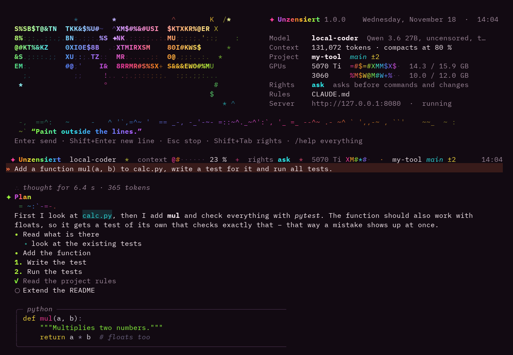

# Look

One shared look for the command line, for the own agent Unzensiert, for Claude Code and for
`claude-local`. There are two styles; which one applies is set in `config\style.json`:

| Style | Character | File |
|---|---|---|
| **Breakout** (active) | colourful, free, loud: pictures made of coloured characters instead of pixels | `config\styles\breakout.json` |
| **Night Shift** | calm, warm: a workshop at night | `config\styles\nightshift.json` |

All colours, glyphs and texts are in the file of the style; it is applied with
`scripts\Install-Style.ps1`.



## Switching the style

Change the value of `active` in `config\style.json` (`"breakout"` or `"nightshift"`), then:

```
powershell -ExecutionPolicy Bypass -File scripts\Install-Style.ps1
```

The script takes the entries of all known styles out and writes only the active one in:
colour scheme, window theme and profile in Windows Terminal are replaced, the theme files of
the old style under `%USERPROFILE%\.claude\themes\` are deleted. Then open a new tab.

Until 2026-11-18 the styles had German names ("Ausbruch", "Nachtschicht"). `formerNames` and
`formerThemes` in `config\style.json` let `Install-Style.ps1` replace their entries as well.

## "Breakout"

### The idea

You can see freedom in colour. The local model runs without a leash on your own graphics
cards, and this style shows that the way you spray onto a wall: pictures made of colourful
letters and characters instead of pixels. The characters do not stay in their letters; they
break out and fly away.

The **amount of colour shows where the model runs**:

| Mood | When | Light | Sign |
|---|---|---|---|
| **Street** | the shell | almost black with violet, pink `#FF3D9A`, cursor acid yellow | `✦` |
| **Free** | Unzensiert and `claude-local`: the model runs on your own graphics cards | the whole colour wheel, the name "Unzensiert" in rainbow colours | `✦` |
| **Cloud** | `claude`: the model runs in the cloud | night blue, only one colour: cyan `#2EE6E6` | `◇` |

The colour wheel: pink `#FF3D9A`, orange `#FF8A1F`, yellow `#FFE03D`, lime `#8CFF3D`, cyan
`#2EE6E6`, blue `#4D8DFF`, violet `#B45CFF`. Between two colours the mix is smooth; after
violet it continues with pink. Even in the cloud the permission questions and the Bash input
stay pink: something happens on your own computer there.

Recurring elements:

- **The picture of characters.** A word is set in a block font, every block filled with a
  random letter or character (`UNZESIRT#@%&$WMXKB08`) and coloured diagonally through the
  colour wheel. The details make it graffiti:
  - **Light from above:** the top row of every letter is lightened, the bottom one darkened
    (`light`).
  - **Shadow:** a dark shadow of `:;.` bottom right behind the letters, as if they stood in
    front of the wall.
  - **Drips:** paint runs down from bottom edges, `|!:` with a drop `'.°` at the end.
  - **Overspray** of light characters (`.,:;'~*+^`) around the letters; the last letter
    crumbles.
  - **Breakout:** to the right characters break out and fly away, first dense ones, then
    `+*=~^%<>/\`, at the end only dots and dashes, paler and paler.
  - **Sparks** `✦ ✧ * +` here and there in the free space.

  Every picture is different; the colours also start at another place of the wheel every
  time.
- **The wall.** Behind the terminal lies a picture of characters: FREE at the bottom right,
  sprayed characters around it, dense in the corner and thinner towards the middle, at 20 %
  opacity so the text in front stays readable. `Install-Style.ps1` draws it anew at every run.
- **Characters flying away everywhere:** at the end of every prompt and every status line,
  before the quote of the greeting and after the farewell. The separators between the parts
  of a line are sprayed (`· * + ~ : %` in a random colour). In the cloud it stays plain.
- **Sprayed line** under every picture: a stroke of `~=-_.,:'^`, thin at the ends, dense and
  bright in the middle.
- **A quote** with every new shell, for example "No filter. No leash.", "Your GPUs, your
  rules." or "Breaking out is a direction too."
- **Sprayed gauges** instead of bars: the filled part consists of random characters
  (`#%&@$*+=WMX`) and runs through the colour wheel, a full gauge shows all colours. The empty
  rest is a pale row of dots `········`. From 70 % context the gauge turns yellow, from 90 %
  red.
- **The prompt changes.** The folder name stands letter by letter in rainbow colours and turns
  a bit further after every command. The prompt sign is a different one every time
  (`» › ! ? # * & % ~ @ ^ $`) in the next colour of the wheel; after a failed command it is
  red.
- **Rebellious activity words:** "Spraying", "Breaking out", "Painting outside the lines",
  "Ignoring stencils", "Breaking the chains", "Stepping out of line" …

### What can be seen where

**Shell** (profile "Breakout" in Windows Terminal), here without colours and in the first
version without shadow, drips, sprayed line and quote (the picture is 10 rows high now):

```
  '                        ,                                                 ~            `      .              ;
  #$     'WZ  X0.    +XB  UUU@Z%RRNE  B0RUZZB%ZT  8E      8X    $#&0B0TK* MSE@NX  0WWE%@8U#@; UR#IEIZ8    NS0UB08EI%     ^ <:
  MT      MT: IW0$    Z&      ` BS   .EB     ^   '@&RE    $X  B&            ZN+   R8   ~ *+   %&   :^ MS    ' IB    TTR    =
  XI      @S  E%  M$  MK      WB      I8SWM0UI~   0M  #8  #M   ^W8ENZT      0@    XIR#$8EK;  ^WR@&W0SI        E+:   @ & *
  BX      ZW  SS:   %ZI@    Z#       `IX ;  ^     RM    KI#R   :      Z$    ZE    %0       ;  EX.+  SX        @%*   R U   =
  : E%WB#$+   %B      M%.'SSZR%ZX&8T  @KIT@@#0%@` KR      8U  0R&%B%RR    &0R0RN  Z0ME&8MXE$; ZB      BS      K8       %  %
               *                   ,  '                         ~          '      +

  free · local · uncensored · colourful                                    Tuesday, November 17 · 17:15

  RTX 5070 Ti   #$*X%*$XXX@@$M#·   15.2 / 15.9 GB   37 °C
  RTX 3060      $&*=*=X@&W=$#@··   10.1 / 12.0 GB   27 °C

  ✦ Free since 14:43. The model runs on your own GPUs.

 ✦ Street  D:\Projects  ·  main ±10                                                                         17:15
 &
```

In the current version the sprayed line follows below, after the line with the server the
quote in rainbow colours, and every prompt ends with a few characters flying away.

The large picture needs about 117 columns. In narrower windows it is set at half width (with
less overspray); below about 60 columns it is left out. If the server is off, a pale star
`✧ Still quiet. claude-local sets it loose.` stands instead of `✦ Free since …`.

**`claude-local`** begins every session with a picture of its own, **FREE**, followed by

```
 ✦ Unzensiert  local-coder  ·  context 57,600 of 64,000 tokens  ·  http://127.0.0.1:8080
   /model switches between local-coder, local-fast, local-qwen38
```

**Claude Code**: its own colour theme per mood ("Breakout · Free", "Breakout · Cloud"), the
activity words and the status line:

```
 ✦ Unzensiert  local-coder  ·  context =+&%#··· 63 %  ·  5070 Ti &%#&W*=  15.2 GB  ·  3060 $W=MM$M· 10.1 GB  ·  Unzensiert main ±10
 ◇ Cloud  Fable 5.2  ·  context =@$@XM$· 93 %  ·  5-h limit $#%@+*·· 81 % until 02:00  ·  Unzensiert main ±10
```

The tab icon is a colour wheel of all colours of the wheel.

**`claude`** (cloud) begins an interactive session with the picture **CLOUD**, all in cyan:
the same technique, but only one colour. With `-p`/`--print` or input through a pipe it does
not appear.

**After a `claude-local` session** the style says goodbye with a sprayed line and
"✦ Session over after 23 min. The characters keep flying."

## "Night Shift"

A workshop at night: a dark, slightly bluish ground, warm text white like paper under a lamp,
brass as the accent. The **colour temperature shows where the model runs**:

| Mood | When | Light | Sign |
|---|---|---|---|
| **Workbench** | the shell | neutral dark, brass `#E9B44C` | `»` |
| **Ember** | Unzensiert, `claude-local` | warm, soot black with ember orange `#FF8A3D` | `●` |
| **High Beam** | `claude` | cool, night blue with ice blue `#9CC4E4` | `◇` |

The ember dot `●` at the front of the prompt glows while `llama-server` runs (otherwise a
pale ring `○`). Gauges `━━━━━━━━` show the memory of the cards, context and the 5-hour limit,
the activity words come from the workshop ("Measuring", "Filing", "Stoking the embers").

```
  U N Z E N S I E R T                              Saturday, November 14 · 23:52

  RTX 5070 Ti   ━━━━━━━━━━━━━━━━   14.5 / 15.9 GB   40 °C
  RTX 3060      ━━━━━━━━━━━━━━━━    7.4 / 12.0 GB   59 °C

  ● The embers have been glowing since 23:50.

 ● Workbench  D:\Projects  ·  main ±6 ↑1                           3.2 s · 23:52
 »
```

## Shared by both styles

When a session starts, the whole window changes its mood (background, text, cursor) and
returns to the mood of the shell when it ends. The prompt shows folder, path to it, git
branch with the number of changed files and how far ahead it is, on the right the duration of
the last command (from 2 s) and the time; after an error "exit 1" with the return value on
the right, as administrator `ADMIN` in red. In local sessions the status line reads the
graphics cards anew every 5 seconds.

If the output is redirected (benchmark, scripts) or the style is not installed, `claude-local`
prints the plain lines `claude-local: model ...` instead, without colour codes and without a
picture.

## The terminal of Unzensiert

Unzensiert draws its terminal itself (`scripts\lib\AgentUi*.ps1`), unlike Claude Code, where
only colour theme, activity words and status line can be set. Every element takes colours and
glyphs from the active style (section `agent` of the style file, colours of the mood "Free"
or "Ember") and its texts from `config\unzensiert-texts.json`. This is what a session looks
like in "Breakout", here without colours (118 columns, shortened); the picture at the top of
this page shows it in colour:

```
                   ✦ *      `            ~ + ` ~   +          ✦ Unzensiert 1.0.0    Wednesday, November 18  ·  13:59
  IS88UWTUZK  XBM#TZN&    &ZB%@UBTUS ^E$U&SMZR%X &    `
  TE::°;;;:;;.0K;.;;..&M  8N:;:;.;°..:%0.;:;:.:;::%~          Model     local-coder  Qwen 3.6 27B, uncensored, t…
  ISNI0&#B    @0K#W%T%  ;;$S#WSS8I^   B8%0T@#X  U  >          Context   131,072 tokens · compacts at 80 %
  &X:..;..:;  B%::.;@M;;  T@;:;.::;: .SS.:.;...;  ✦ <         Project   my-tool  main ±2
  Z0::       ~%8:.  : B@+,MENS%Z&@%#. M#$0U88X~\  +           GPUs      5070 Ti  *W=$@X%=#&@·  14.3 / 15.9 GB
  + .:          ;;  '  *..  .;;;::.;;:  ...:;.:;.;                      3060     X==@+==X%%··  10.0 / 12.0 GB
               ✧                                              Rights    ask  asks before commands and changes
                                                &   >         Rules     CLAUDE.md
                +                               K             Server    http://127.0.0.1:8080  ·  running

   ^      -  : - ,  -:. = -'==:-  =, ^ ,~..'~=~~_=,:~_^=--~-`~=_~ ^ ~~_`='~-'-`.-  .  ~ _  ` ~. `  ~    .
    ' “Freedom runs locally.”
  Enter send · Shift+Enter new line · Esc stop · Shift+Tab rights · /help everything

» Add a function mul(a, b) to calc.py, write a test for it and run all tests.

  ∴ thought for 6.4 s · 365 tokens
✦ Plan
  .  '_-.'`'
  First I look at calc.py, then I add mul and check everything with pytest. The function should also work with
  floats, so it gets a test of its own that checks exactly that – that way a mistake shows up at once.
  • Read what is there
    ◦ look at the existing tests
  1. Write the test
  ✓ Read the project rules
  ○ Extend the README

  ╭─ python ──────────────────────────────────────────────────────
  │ def mul(a, b):
  │     return a * b  # floats too
  ╰───────────────────────────────────────────────────────────────

✎ Edit  calc.py
  ⎿  ✓ line 5  ·  -2 +2
     5   def mul(a, b):
     6 -     """Multiplies."""
     7 -     return a + b
     6 +     """Multiplies two numbers."""
     7 +     return a * b

❯ Bash  python -m pytest -q
  ⎿  ✗ exit 1  ·  1.8 s
     ..F
     … +4 lines
     FAILED tests/test_calc.py::test_mul_float - assert 2 == 2.0
     1 failed, 2 passed in 0.08s

  ╭─ ! The guard asks  ❯ PowerShell ──────────────────────────────────────────────────────────────────────────────
  │ Remove-Item -Recurse -Force build
  │ Reason: guard rule delete-recursive: a recursive delete always asks
  ╰───────────────────────────────────────────────────────────────────────────────────────────────────────────────
   y  yes     n  no   ›

✦ Done: mul multiplies now, and the new test checks floats as well.

   File               │ Change
  ────────────────────┼───────────────────
   calc.py            │ mul returns a * b
   tests/test_calc.py │ new, 3 tests

  ✦ Put it on the wall in 1 min 24 s  ·  9 rounds  ·  3 files changed  ·  1,873 tokens  ·  61 tok/s  *~

» 

 ✦ Unzensiert  local-coder  :  context $W······ 24 %  +  rights ask  %  5070 Ti *W=$@·  3060 X==@··  ~  my-tool main ±2  14:01
```

The elements, from top to bottom:

| Element | What it shows | "Breakout" | "Night Shift" |
|---|---|---|---|
| **Welcome** | picture of characters (`agent.bannerText`) and next to it the facts of the session: version, date, model with description, context window, project with git state, memory of every graphics card, rights, project instructions, server; in narrow windows (below `bannerWidth` + 52 columns) below it. Then sprayed line, quote and keys | picture FREE, quote in the colours of the wheel | instead of the picture the spaced name `U N Z E N S I E R T` in ember orange, plain line |
| **Status bar** at the bottom | mood and model, context as a gauge with percent, rights (ask calm, edits green, all yellow), every graphics card with a gauge of its memory, folder and git, speed of the last answer, the time on the right. It always stands under the text, with an empty row between (room for a second row of input): while you type, while the model thinks, writes and works; once the window is full, that is its bottom edge. The cards come from `nvidia-smi` (NVIDIA) and from the memory counters of Windows (Intel Arc, AMD Radeon; integrated graphics left out), read again every `agent.barRefreshSeconds` while something runs. In a narrow window one step after the other until it fits: speed and time go, the folder loses git, the model the name of the mood, the cards their names (`GPU` with gauges), the context its gauge; then folder, cards, context and rights go | sprayed gauges and separators | solid gauges |
| **Input** | prompt sign in a changing colour; after Enter your message stands on a coloured bar across the whole width | sign and colour change with every input | `»` in brass |
| **Activity line** | while nothing else is shown: a turning sign, what is happening (an activity word of the style, "thinking · 340 tokens", "writing Write", "running", "closing check", "summarising the conversation"), the time so far, "Esc stops". It disappears as soon as something else appears | sparkling star, the activity word runs through the colour wheel, characters flying away | `◐◓◑◒` in ember orange, a light runs through the word |
| **Tab and taskbar** | title of the window: what Unzensiert is doing and in which folder; in Windows Terminal also the progress ring on the tab (OSC 9;4), red after an error until the next input. When it ends, the old title comes back | | |
| **Thinking** | afterwards a quiet line "∴ thought for 6.4 s · 365 tokens"; with `/think` the thinking itself, pale and italic behind `┊` | | |
| **Answer** | sign of the style before the first line; Markdown: headings (the first in the colour wheel with a sprayed stroke), lists with one sign per level, numbers, open and done tasks (`○`, `✓`), quotes (`▌`), rules, tables with aligned columns, `code` on a tinted ground, **bold**, *italic*, ~~struck through~~, links (clickable in Windows Terminal). Every line is wrapped at word boundaries, lists with a hanging indent | bullets and headings in the colour wheel | in ember orange |
| **Code** | in a frame with the name of the language, in the colours of the shell's input line (`shell.syntax`): keywords, strings, numbers, comments, variables, functions, types. Python, PowerShell, Bash, JavaScript/TypeScript, C-like (C, C++, C#, Java, Go, Rust, Arduino …), JSON, YAML, INI/TOML, SQL, Lua, Batch, HTML/XML, CSS, Diff | | |
| **Tools** | header line with sign and colour of the tool (`agent.tools`), commands in the colours of their shell; below it `⎿` with tick or cross and duration. Commands: beginning and end of the output ("… +4 lines" in between), error lines red, success green. Read: lines; Write: new or replaced, the first lines with numbers; Glob and Grep: matches with file and line | ❯ orange, ≡ cyan, ✎ pink, ✚ lime, ⌕ violet and yellow | muted workshop colours |
| **Changes** (Edit) | diff with line numbers: unchanged lines pale, removed and added ones on a red and green tinted ground across the whole width, the changed characters stronger, the code in its colours; long unchanged stretches folded (`⋯`) | | |
| **Question** | a frame: the command in its colours, for Edit the diff, for Write the beginning of the file, below it the reason; then the keys as badges `y` yes, `a` always (with the rule, for example `Bash(python:*)`), `n` no. Afterwards the answer replaces the keys | yellow; when the guard asks, pink with `!` and without "always" | brass, ember orange for the guard |
| **Notes** | a sign per kind: `·` pale, `✓` fine, `!` warning, `✗` error, long notes wrapped | | |
| **End of a request** | "✦ Put it on the wall in 1 min 24 s · 9 rounds · 3 files changed · 1,873 tokens · 61 tok/s" with a word of the style (`agent.doneVerbs`); after Esc "■ stopped after 12 s", after a break-off in red | Sprayed, Broke out, Tagged … | Forged, Filed, Hardened … |
| **Overviews** | `/help` (keys, commands, workflows), `/status` (context with gauge, tokens of the session, rights, what is allowed, rules, changed files), `/model` and `/resume` as lists under small headings | | |
| **Farewell** | sprayed line, "Session over after 23 min. The characters keep flying.", requests, rounds, tokens read (of which from the cache) and written, changed files, what happened to the models | | "Session over after 23 min." |

If the output is redirected (`unzensiert -p`, benchmark), Unzensiert draws none of it;
standard output only contains the result.

## Setting it up

```
powershell -ExecutionPolicy Bypass -File scripts\Install-Font.ps1     # once: the font IBM Plex Mono
powershell -ExecutionPolicy Bypass -File scripts\Install-Style.ps1    # apply, repeat after every change
```

Then open a new tab in Windows Terminal. Running Claude Code sessions take the theme over at
their next start.

`Install-Font.ps1` downloads the font of the active style (both use IBM Plex Mono, SIL Open
Font License) and installs it only for the signed-in user, without administrator rights.

`Install-Style.ps1` changes:

| Place | What |
|---|---|
| `settings.json` of Windows Terminal | colour scheme and window theme with the name of the style; under `profiles.defaults` font, padding, cursor; a profile with the name of the style as the default profile (fixed GUID from `config\style.json`, a switch replaces it). The existing profiles stay. |
| `%USERPROFILE%\.claude\themes\` | two themes per style: `breakout-free.json`, `breakout-cloud.json` (or `nightshift-ember.json`, `nightshift-highbeam.json`) |
| `%USERPROFILE%\.claude\settings.json` | `theme` (cloud mood), `statusLine`, `spinnerVerbs` |
| `%LOCALAPPDATA%\<style>\<mood>.png` | the tab icon, drawn by the script |
| `%LOCALAPPDATA%\<style>\wall.png` | only for styles with `terminal.wall`: the wall of characters, as `backgroundImage` of the profile (bottom right, not stretched, opacity from `opacity`) |

Before the first change every settings file is copied once to `<name>.vor-nachtschicht`
(`backupSuffix` in `config\style.json`; the German name stayed because the existing backups
are called that). Switches:

- `-PreviewDir <folder>` writes the results into a folder instead of changing anything.
- `-Remove` takes exactly the entries of all styles out again; everything else in the files
  stays as it is. The font stays installed.

The profile starts PowerShell with `-ExecutionPolicy RemoteSigned` for that process only. The
execution policy of the system is not changed, and no PowerShell profile is created under
`Documents`.

Found while renaming (2026-11-18): versions before wrote the profile in Windows Terminal with
`"guid": null`, so the script never recognised its own profile. It now always gets the fixed
GUID, and a profile named after a style (also a former one) counts as the script's own.

## Customising

`config\style.json`:

| Key | Content |
|---|---|
| `active` | the style, name of a file in `config\styles\` |
| `profileGuid`, `modeVariable`, `backupSuffix` | shared by all styles: profile in Windows Terminal, variable `CLAUDE_LOCAL_LOOK` by which the status line recognises a local session, ending of the backups |
| `formerNames`, `formerThemes` | names and Claude Code theme files of earlier versions, taken out like those of the current styles |

A style file in `config\styles\`, then `scripts\Install-Style.ps1`:

| Section | Content |
|---|---|
| `modes` | per mood: background, text, cursor, accent, pale tones, sign, name; optionally `labelInk` and `gaugeInk` = `"rainbow"` (name and gauges in the colour wheel) and `trail` (sprayed separators, characters flying away) |
| `rainbow.colors` | the colour wheel (colourful styles only) |
| `ink` | colours with a meaning: fine, warning, error, ember, git branch |
| `palette` | the 16 ANSI colours of the terminal |
| `glyphs` | signs; `prompt` may be a list (then a different one every time), `gaugeSpray` = characters for sprayed gauges, `sepSpray` = sprayed separators |
| `texts` | texts of prompt, greeting, status line, `tagline` under the picture, `quotes` (list, one each time), `farewell` (goodbye after `claude-local`) |
| `art` | picture of characters: `text` (shell), `bannerText` (`claude-local`), `cloudText` (`claude`, one colour), `scale`, character supplies `fill`, `spray`, `flightMid`, `flightFar`, density `sprayChance`, `flightDensity`, `flightReach`, `gradientSpan`; details `light`, `shadow`, `dripBody`, `dripEnd`, `dripChance`, `dripLength`, `sparkle`, `sparkleChance`, `line` (sprayed line); the block font `font` (A–Z, 0–9, `! ? - .`, 5 rows each) |
| `font` | font, size, line height, source for `Install-Font.ps1` |
| `terminal` | padding, cursor shape, colour of the tab row and the window frame; `wall` = wall of characters behind the terminal (`text`, size in `cols` × `rows`, `fontPixels`, `opacity`, `alignment`) |
| `shell` | `mode` (mood of the shell), greeting on/off (`greeting`), `rainbow` (colourful folder name, changing colour of the prompt sign), `trail` (columns of characters flying away at the end of the prompt), from when the duration appears, colours of the input |
| `claude` | themes for Claude Code (`themes`), moods for local and cloud, activity words (`spinnerVerbs`, also for the activity line of Unzensiert), thresholds of the status line |
| `agent` | the terminal of Unzensiert (see below) |

The section `agent` (without it plain defaults apply):

| Key | Content |
|---|---|
| `bannerText`, `bannerScale`, `bannerWidth` | picture of the welcome (word, largest widening, columns for the picture next to the facts) |
| `title` | name above the facts in styles without `art` |
| `spinner`, `spinnerInk` | signs of the activity line (one per frame) and their colour |
| `verbInk`, `headingInk`, `promptInk` | colour of the activity word, of headings and end lines, of the prompt sign |
| `verbs` | activity words; without the key those of `claude.spinnerVerbs` |
| `doneVerbs` | words for a finished request ("Sprayed in 42 s") |
| `marks` | signs for answer, thinking, result (`corner`), end, stopped, showing the thinking |
| `notes` | signs of the notes: `dim`, `ok`, `warn`, `error` |
| `bullets`, `quote`, `box` | bullets per level, sign before quotes, frame (top left, bottom left, line, side) |
| `rule` | rules: `spray` (sprayed) or `line` |
| `trail` | columns of characters flying away at the end of activity and end lines (0 = none) |
| `tools` | per tool `icon` and `ink` |
| `diffTint`, `diffStrong` | how strongly the ground of removed and added lines and of the changed characters is tinted (1 = not at all) |

Colours are `#RRGGBB`, `rainbow` (colour wheel), `shimmer` (a light runs through) or `accent`
(accent of the mood). The texts of the terminal that are the same in every style (labels,
notes, questions, help) are in `config\unzensiert-texts.json`; `{0}`, `{1}` are placeholders,
a list with two entries under `count` is singular and plural. `Test-Setup.ps1` checks that
every text the code asks for is there.

Examples: another word in the picture is `"text": "FREEDOM"`. Without drips:
`"dripChance": 0`. Without a wall: delete the section `terminal.wall` and run
`Install-Style.ps1`. More or less wall: `opacity` between 0.1 and 0.3. A fixed prompt sign is
`"prompt": "»"`. A new style is a copy of a style file with another `name` and
`claude.themePrefix`.

Changes to prompt, greeting, picture and status line take effect at once in the next tab or
at the next call, because the scripts read the style file at every start. Only for Windows
Terminal and the files of Claude Code does `Install-Style.ps1` have to run again.

The keys under `claude.themes.*.overrides` are the colour names of Claude Code (`claude`,
`text`, `permission`, `diffAdded` ...). Claude Code silently ignores unknown names.

## Structure

```
config\style.json            which style applies, what all styles share
config\styles\*.json         per style: colours, signs, texts, block font
scripts\lib\Style.ps1        building blocks: read the style, colours, colour wheel, gauges, tinting the terminal, readings
scripts\lib\CharArt.ps1      pictures of characters: block font, filling, light, shadow, drips, overspray, sparks, characters breaking out; the wall as PNG
scripts\lib\AgentUi.ps1      terminal of Unzensiert: welcome, activity line, notes, input, overviews, farewell
scripts\lib\AgentUiBar.ps1   the status bar at the bottom; Write-UiOut, through which everything is printed
scripts\lib\AgentUiMarkdown.ps1  the answer: Markdown, wrapping, tables, colours of code
scripts\lib\AgentUiTools.ps1     tools, diffs, questions
config\unzensiert-texts.json  texts of the terminal of Unzensiert
scripts\style\Shell.ps1      sets up the interactive shell (prompt, greeting, function claude)
scripts\style\Statusline.ps1 status line of Claude Code
scripts\Install-Style.ps1    applies the active style to Windows Terminal and Claude Code
scripts\Install-Font.ps1     installs the font
```

`lib\Style.ps1` reads the style files itself and not through `lib\Config.ps1`: shell and
status line load only this file (and `CharArt.ps1`), so they start fast and
`$ErrorActionPreference = 'Stop'` from `_common.ps1` does not get into the interactive shell.

This is how the mood comes about:

- **Tinting the window:** `Set-TerminalPalette` sends the control sequences OSC 10, 11 and 12
  (text, background, cursor). That only happens in Windows Terminal, only when the style is
  installed and only when the output is not redirected.
- **`claude` in the shell** is a function that sets the window to the cloud mood, starts
  `claude.exe` with all arguments and returns afterwards.
- **`claude-local`** sets `CLAUDE_LOCAL_LOOK` to the local mood, switches the window and hands
  over the local theme and the status line with a 5-second interval for this launch
  (`Get-LocalLookSettings`). The status line tells by the variable whether it shows graphics
  cards or the limit.
- **The picture** is set by `Get-CharArtCells` (`lib\CharArt.ps1`): word → grid of blocks of
  the block font, stretched as wide (`scale`) as the window allows, then cell by cell letter,
  drip, shadow, overspray, breaking-out character or spark, the colour from the colour wheel
  (or one colour), lightened or faded towards the background. `Format-ArtCells` turns that
  into terminal lines, `Save-ArtCellsImage` into a PNG (the wall from `New-CharWall`). With a
  fixed seed (`-Seed`) the same picture always comes out; `Test-Setup.ps1` uses that.

## Measured and not measured

Measured on 2026-11-17 (Windows PowerShell 5.1), "Breakout" with shadow, drips and sparks:

| | Duration |
|---|---|
| picture UNZENSIERT, first drawing in the process (greeting) | about 240 ms (before, without details, 145 ms) |
| the same picture, further times | about 75 ms |
| picture FREE before `claude-local` | about 35 ms |
| drawing the wall and saving it as PNG (`Install-Style.ps1`) | about 310 ms |
| loading `lib\Style.ps1` | about 70 ms |
| one run of the status line (local, with `nvidia-smi`) | about 480 ms |

Terminal of Unzensiert, measured on 2026-11-18 (Windows PowerShell 5.1, window 120 columns,
mean of several passes after a first one; a benchmark ran at the same time):

| | Duration |
|---|---|
| loading all scripts (`_common.ps1`) | about 265 ms (before 235 ms) |
| welcome, first time in the process (with `nvidia-smi`, git, picture) | about 480 ms |
| status line (with `nvidia-smi`) | about 90 ms |
| one frame of the activity line (at most ten per second) | about 4 ms |
| one line of the answer with Markdown, on average | about 2 ms |
| paragraph of 220 characters with bold, code and link | about 4 ms |
| line of code with colours | about 1 ms |
| diff of the sample (3 lines) / 60 lines with 8 changes | about 11 ms / 34 ms |

Status bar of Unzensiert, measured on 2026-11-21 (Windows PowerShell 5.1, 120 columns, written
into a buffer after a first pass, a model loaded in llama-server):

| | Duration |
|---|---|
| building the line of the bar (only when something in it has changed) | about 10 ms |
| one written line with the bar drawn again under it | about 0.2 ms |
| an answer of 481 words as it streams in | about 180 ms (about 167 ms without the bar) |
| reading cards and git (before every input; while something runs the cards every 5 s, git after every tool) | 83 to 357 ms |
| memory counters of Windows (cards without `nvidia-smi`): first read in the process / later | about 400 ms / about 1 ms |

Checked for the bar: `Test-Agent.ps1` replays a request in a small terminal emulator (the bar
is the last row, once, nothing of it in the scrollback, the cursor where the text goes on, every
width fits); a real but hidden console window (conhost) with PSReadLine 2.0.0 was typed into by
a script and its screen read back: the bar stays at the bottom during the answer, while typing
one, two and three rows of input and after Enter; the scrollback holds every line once. The
memory counters were read on this machine with `nvidia-smi` hidden: within 10 MiB of
`nvidia-smi`. Not checked: the look in a real Windows Terminal window, and a real Intel or AMD
card (the tests use made-up adapters).

For "Night Shift", measured on 2026-11-14: start of the shell with greeting about 440 ms, one
prompt in a git folder about 30 ms, one run of the status line about 380 ms.

Checked: `Test-Setup.ps1` (style files complete, block font consistent, picture fits into the
width and is left out in windows that are too narrow, the cloud picture stays in its colour,
gauges, sprayed line and trail exactly as wide as asked, the wall has the requested size, the
status line reads model and context from stdin). Cloud picture, farewell and wall were also
rendered and looked at. Greeting, prompt, banner and both status lines were rendered as
pictures and looked at (own renderer, font Cascadia Mono); "Night Shift" looks as before with
the rebuilt code. When switching, `Install-Style.ps1` replaces scheme, theme, profile and theme
files; a second run changes nothing more.

The terminal of Unzensiert was rendered in both styles and at 80, 100 and 120 columns and
looked at (own renderer, IBM Plex Mono), after the switch to English again in both styles. A
test lets an answer arrive piece by piece with pauses: activity line, raw lines and wrapped
lines leave nothing behind, the final picture equals that of an answer in one piece. Tests
check wrapping, diff and colours of code (no character gets lost).

**Not checked:** the look in a real Windows Terminal window with IBM Plex Mono; for Unzensiert
the title and the progress ring on the tab, the bar behind your own input after PSReadLine and
the signs `✓ ✗ ✎ ✚ ⌕ ❯ ≡ ⎿` (one column wide?); how strongly the wall works at 20 % opacity
in the window, in particular whether `✦`, `✧` and `◇` are exactly one column wide there; and
whether Claude Code accepts the themes "Breakout · Free" and "Breakout · Cloud" without a
message.
